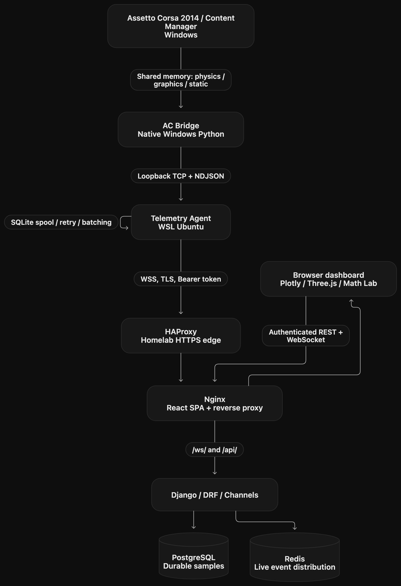

# Drift Telemetry Lab

**An experimental, self-hosted Assetto Corsa telemetry and linear algebra learning platform.**

Drift Telemetry Lab captures driving telemetry from **Assetto Corsa (2014)** running on Windows with Content Manager, forwards the data through **WSL Ubuntu** to a **Django homelab backend**, and presents driving sessions through interactive **2D charts**, **3D replays**, and **math exercises with optional worked solutions**.

The project serves two purposes:

1. **Driving analysis:** review throttle, brake, clutch, steering, RPM, gear selection, speed, and recorded trajectories to investigate what happened before a spin or off-track event.
2. **Mathematics education:** connect observed vehicle motion to matrices, linear systems, vector spaces, subspaces, linear combinations, linear independence, bases, dimensions, and coordinate transformations.

> **Project status:** Prototype / educational MVP (v4 code snapshot). Several components and tests are implemented, but real Assetto Corsa calibration, complete browser/build validation, end-to-end Docker deployment, and a physics-based optimal drift-line planner are **not verified**. See [Project status and limitations](docs/STATUS_AND_ROADMAP.md).

## System overview



The Windows bridge reads the game's Windows shared-memory mappings. The WSL agent provides buffering and reliable handoff. The homelab stores data and offers APIs; the browser visualizes it. **The browser never receives the ingestion Bearer token.**

## Technology stack

| Area | Stack | Role |
| --- | --- | --- |
| Game integration | Python, `ctypes`, Windows file mappings | Read Assetto Corsa shared-memory data |
| Local relay | TCP, newline-delimited JSON (NDJSON) | Windows → WSL telemetry frames |
| WSL agent | Python `asyncio`, SQLite, `websockets` | Validate, spool, batch, retry, transmit |
| Backend | Python, Django, Django REST Framework, Channels, Daphne | Sessions, ingestion, analysis, education, API |
| Persistence / messaging | PostgreSQL, Redis | Durable telemetry / best-effort live fan-out |
| Frontend | React, TypeScript, Vite | Browser UI and shared replay state |
| Charts / 3D | Plotly.js, Three.js, React Three Fiber | Cartesian charts, session playback |
| Reusable packages | NumPy, `telemetry_schema`, `drift_math`, `drift_analysis` | Typed protocol, mathematical operations, analysis |
| Deployment | Docker Compose, Nginx, HAProxy | Containerization, same-origin routing and TLS |

## Repository layout

```text
drift-telemetry-lab/
├── ac-bridge/                # Native Windows process reading Assetto Corsa
│   ├── shared_memory.py
│   ├── telemetry_reader.py
│   └── publisher.py
├── telemetry-agent/          # WSL listener, normalizer, durable spool, WSS sender
│   ├── receiver.py
│   ├── normalizer.py
│   ├── buffer.py
│   ├── transport.py
│   └── main.py
├── backend/                  # Django project
│   ├── config/
│   ├── sessions/
│   ├── telemetry/
│   ├── analysis/
│   └── learning/
├── frontend/                 # React + Vite
│   └── src/
│       ├── components/
│       ├── modules/telemetry/
│       ├── modules/cartesian-2d/
│       ├── modules/trajectory-3d/
│       ├── modules/math-lab/
│       └── pages/
├── packages/
│   ├── telemetry-schema/
│   ├── drift-math/
│   └── drift-analysis/
├── infrastructure/           # Homelab Compose, HAProxy, TLS setup
├── examples/                 # Offline analysis example
├── tests/                    # Independent package tests
└── docs/                     # Project-wide English documentation
```

The project is organized as a **monorepo**, but the Windows bridge, WSL agent, backend and frontend run as separate processes. The Python packages are installable independently and do not require Django for mathematical experiments.

## What is implemented?

| Capability | Current scope |
| --- | --- |
| Assetto Corsa acquisition | Reads physics, graphics, and static pages on Windows; runtime calibration still required |
| Local transport | Windows TCP/NDJSON → WSL receiver, normally on port `8765` |
| Resilient relay | SQLite-backed WSL spool; full-batch acknowledgement and resend |
| Backend ingest | `WS /ws/ingest/`, Bearer authorization, transactional persistence and deduplication |
| Session history | One `DrivingSession` per **bridge `stream_id`**, REST listing and paginated samples |
| Live dashboard | `WS /ws/sessions/{UUID}/live/`, REST recovery, session-based authentication |
| 2D / 3D | Time-series charts, X/Z Cartesian plot and positional replay with full track maps and mod-aware car metadata |
| Learning mode | Eight initial exercise topics, answer check, optional step-by-step reveal |
| Offline Python analysis | Steering/throttle events, exploratory drift detection, recorded-reference comparisons |
| Infrastructure | Compose definition, Nginx reverse proxy and HAProxy HTTPS entry point |

A **recorded reference** is not an **optimal trajectory**. Engine RPM alone cannot define a physically feasible or optimal drift line.

## Quick start

### Requirements

- **Windows:** Assetto Corsa 2014 with Content Manager; native Windows Python 3.12+ for the bridge.
- **WSL Ubuntu:** Python 3.12+ recommended for reusable packages; Node.js 22.12+ and npm for Vite 7.
- **Backend development:** Django dependencies installed from `backend/requirements-dev.txt`.
- **Homelab deployment:** Docker Engine, Docker Compose, internal DNS, and a trusted TLS certificate.

### 1 — Start the Django development backend (WSL)

```bash
cd drift-telemetry-lab/backend
python3 -m venv .venv
source .venv/bin/activate
python -m pip install -r apps/backend/requirements.txt
python manage.py migrate
python manage.py createsuperuser
python manage.py runserver 127.0.0.1:8000
```

Development uses SQLite by default and the in-memory Channels layer when Redis is not configured. **Never use this debug configuration for internet-facing deployment.**

### 2 — Start the WSL Telemetry Agent

In another terminal:

```bash
cd drift-telemetry-lab/telemetry-agent
python3 -m venv .venv
source .venv/bin/activate
python main.py --allow-insecure-dev
```

For local development, both processes automatically load `apps/backend/.env`.
Create that file from `.env.example` and set the same `TELEMETRY_TOKEN` in it.
Install the requirements once; after that no `source` or repeated `export`
commands are needed. Shell variables still override values from the file.
Restart the process after changing the file.

**Packaging note:** the v4 integrated archive does not contain `telemetry-agent/requirements.txt`, although a legacy component README references it. The `websockets` installation above is a practical development substitute; pin and verify the exact version in your environment before deployment. Plain `ws://` is permitted by the agent **only for explicit loopback development**.

Alternatively, start the agent with `python main.py --capture-only` to buffer locally without forwarding to Django.

### 3 — Start the Windows AC Bridge

With the game running and a live driving session active, in Windows PowerShell:

```powershell
cd path\to\drift-telemetry-lab\ac-bridge
py -3 publisher.py --host 127.0.0.1 --port 8765 --hz 50
```

The bridge refreshes the car, skin and track IDs from shared memory and the active `Documents\Assetto Corsa\cfg\race.ini` or `entry_list.ini` while the game loads. It reads `CAR_0/MODEL`, `CAR_0/SKIN`, `TRACK/MODEL`, and `CONFIG_TRACK`, then switches automatically when the session or livery changes. It also checks localized and OneDrive Documents folders. It scans Steam libraries automatically and discovers stock or modded assets under `content/cars/<car-id>` and `content/tracks/<track-id>`. Set `AC_ROOT` once, or use `--ac-root`, only when the installation is outside the detected Steam libraries. `--car-id` and `--track-id` remain optional diagnostic overrides, not normal startup requirements. The browser cannot load AC's `.kn5` directly: the model server converts the detected car and active skin to a cached GLB on demand; otherwise the frontend uses its adaptive fallback.

For the exact 3D car and livery, install the optional MIT-licensed converter once on the Windows Python used by the bridge. Because this repository is in WSL, run the installation from a local Windows directory rather than `\\wsl.localhost\...`: `Set-Location C:\Temp; py -3 -m pip install "https://github.com/semiloker/assetto-corsa-gltf/archive/refs/heads/main.zip"`. The bridge starts a local model server on port `8766`, automatically selects the top-detail KN5 and active `CAR_0/SKIN` for any detected stock or modded car, converts it to a skin-specific cached GLB on first request, and Vite proxies `/car-models/` to it. Set `AC_MODEL_SERVER_PORT` and `VITE_CAR_MODELS_TARGET` together only if that port is unavailable.

On a typical WSL2 configuration, Windows-to-WSL localhost forwarding works. If it does not, check WSL networking **before** binding the receiver to a non-loopback address; the local TCP protocol is unauthenticated.

### 4 — Run the frontend

```bash
cd drift-telemetry-lab/apps/frontend
cp .env.example .env
npm install
npm run dev
```

Open **http://127.0.0.1:5173** locally, or `http://<windows-lan-ip>:5173` from another machine. The frontend starts in live mode. Sign in through `/admin/login/` using a Django staff account and select a session; enable Demo Mode only for synthetic samples.

The Vite dev proxy routes `/api/`, `/admin/`, `/ws/`, `/static/`, and `/healthz/` to the backend.

See [Getting started](docs/GETTING_STARTED.md) for detailed setup, verification and common pitfalls.

## Homelab deployment

The production-oriented deployment definition is `infrastructure/compose.yaml`, designed to run from the **repository root**:

```bash
cp infrastructure/.env.example infrastructure/.env
chmod 600 infrastructure/.env
# Edit infrastructure/.env and provision a trusted TLS certificate first.

python -m pip install pyyaml
python infrastructure/scripts/check_config.py

docker compose --env-file infrastructure/.env \
  -f infrastructure/compose.yaml config --quiet

docker compose --env-file infrastructure/.env \
  -f infrastructure/compose.yaml up -d --build
```

Only HAProxy binds a host port, initially **127.0.0.1:8443**. To allow devices on your LAN, configure an appropriate LAN bind address, firewall rules, DNS, TLS certificate, Django allowed hosts, and CSRF trusted origins. See [Deployment and security](docs/DEPLOYMENT_AND_SECURITY.md).

## API highlights

| Method | Endpoint | Description |
| --- | --- | --- |
| `GET` | `/healthz/` | Database-backed health check |
| `GET` | `/api/sessions/` | List captured streams |
| `GET` | `/api/sessions/{UUID}/samples/?after=-1&limit=250` | Sequence-based sample pagination |
| `GET` | `/api/sessions/{UUID}/analysis/` | Session summary and exploratory events |
| `GET` | `/api/sessions/{UUID}/analysis/compare/?reference={UUID}` | Compare against another recorded run on the same track |
| `GET` | `/api/learning/topics/` | List currently supported learning topics |
| `GET` | `/api/sessions/{UUID}/exercise/?topic=displacement` | Exercise inputs and expected result; solution hidden |
| `GET` | `/api/sessions/{UUID}/exercise/?topic=displacement&reveal=1` | Include a worked solution |
| `POST` | `/api/sessions/{UUID}/exercise/check/` | Check the student's answer |
| `WS` | `/ws/ingest/` | Token-authenticated agent batch ingestion |
| `WS` | `/ws/sessions/{UUID}/live/` | Session-authenticated, read-only live feed |

The REST endpoints require a **logged-in Django staff user**. The ingestion token is exclusively for the agent and must not be placed in frontend JavaScript. See [Protocol and API](docs/PROTOCOL_AND_API.md).

## Linear algebra and drift analysis

The package `drift_math` is organized around concepts from the course: matrix arithmetic and inverses; Gaussian elimination, rank, nullity, and linear systems; vector spaces and subspaces; linear combinations and independence; ordered bases, dimensions and transformations.

`drift_analysis` adds physically motivated but **exploratory** analytics: sideslip intervals (after coordinate calibration), rapid steering/throttle events, and deviation from a **recorded** reference. The Django API currently uses its earlier analysis services; installing the new packages does not automatically expose every package function over HTTP.

The Math Lab shows **inputs and expected output first**. Students can calculate by hand, submit an answer, and reveal the mathematical steps on demand. See [Mathematics and learning](docs/MATH_AND_LEARNING.md).

## Testing

Independent Python packages:

```bash
# From the repository root
python3 -m venv .venv
source .venv/bin/activate
python -m pip install -e packages/telemetry-schema \
  -e packages/drift-math -e packages/drift-analysis
python -m pip install pytest pyyaml
python -m pytest tests/ -q
python infrastructure/scripts/check_config.py
```

Django (with its development requirements installed):

```bash
cd backend
python manage.py check
python manage.py makemigrations --check --dry-run
python -m pytest tests/ -q
```

Frontend (with npm dependencies installed):

```bash
cd frontend
npm run typecheck
npm test
npm run build
```

**Validation boundary:** passing pure-package tests or static checks does not prove the Windows game integration, UI rendering, TLS trust chain or Compose runtime is working. Those require validation in your own Windows/WSL/homelab environment.

## Documentation

- [Getting started](docs/GETTING_STARTED.md) — local startup and first live session.
- [Architecture](docs/ARCHITECTURE.md) — responsibilities, diagrams, data lifecycle and storage.
- [Protocol and API](docs/PROTOCOL_AND_API.md) — message formats, idempotency and endpoints.
- [Mathematics and learning](docs/MATH_AND_LEARNING.md) — linear algebra mapping and analytic caveats.
- [Deployment and security](docs/DEPLOYMENT_AND_SECURITY.md) — TLS, Docker, credentials and operations.
- [Status, limitations and roadmap](docs/STATUS_AND_ROADMAP.md) — what is implemented vs. planned.

## Safety and limitations

This is a **sim-racing research/learning tool**, not a real-vehicle safety controller. Event detectors produce hypotheses, not diagnoses of driver error. Before interpreting drift angles or steering directions, calibrate coordinate axes, unit conventions, mods and the model orientation against game behavior.

**License:** no project license was found in the v4 code archive. Do not assume the repository grants open-source redistribution rights until a license is explicitly added.
